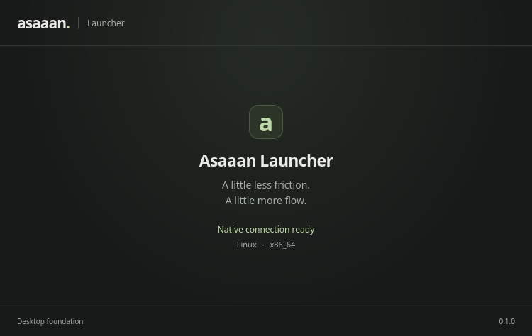

# CP001: Desktop foundation

**Local implementation, validation and deployment complete. Release publication historically unverified. The user subsequently reviewed this build and explicitly authorized CP002 on branch checkpoint-2.**

## Scope delivered

- Product name Asaaan Launcher; package asaaan-launcher; bundle ID com.asaaan.launcher.
- Tauri 2.12 with React/TypeScript and Rust. Native window at Floe's 750 × 474 logical content size.
- Native identity response and explicit connecting, ready, error and browser-preview states.
- Seven frontend tests, one Rust wire-contract test, actual installed-app frontend/Rust smoke test.
- Linux Debian package, versioned workspace-local installation and local desktop shortcut.
- Three-platform CI configuration prepared; external CI and public release not run.

This is a foundation screen, not the eventual Floe interface. Native blur, search, hotkeys, resident services and extensions are outside this checkpoint.

## Gate evidence

Validated on Linux x86_64 with GTK 3.24.41 / WebKitGTK 2.52.6, Node 22.17.0, npm 10.9.2, Rust 1.95.0. This machine's active desktop was accessed through its X11 display; Wayland is not certified by this check.

| Gate | State | Evidence |
|---|---|---|
| Implementation | Passed | Shell, real IPC, naming, identity, error/retry and browser-preview states |
| Frontend validation | Passed | npm run check: TypeScript and 7 tests in 2 files |
| Reproducible frontend install | Passed | npm ci --ignore-scripts succeeds from the lockfile; npm audit reports 0 known vulnerabilities |
| Rust validation | Passed | npm run native:check: formatting, 1 Rust test, doc/bin test targets, Clippy all-targets with warnings denied |
| Production frontend/native build | Passed | npm run package:linux; 1.81 MiB Debian package |
| Workspace-local installation | Passed | npm run install:local; exact package identity/version/architecture checked; binary hash verified on launch |
| Packaged-app smoke | Passed | npm run smoke:local on the installed artifact prints ASAAAN_NATIVE_SMOKE_OK and exits 0 |
| Native desktop run | Passed | npm run start:local; visible 750 × 474 X11 window; screenshot inspected |
| Desktop shortcut | Passed | desktop-file-validate deployments/linux/Asaaan Launcher.desktop |
| macOS/Windows checks | Not run | CI prepared; requires corresponding native runners |
| Downloadable release | Pending | User will add the release remote after local review. No publication attempted |

## Local deployment

The package is extracted under deployments/linux/versions and selected with an atomic current symlink. This is a workspace-local installation, not a system-wide dpkg install or application-menu registration. It needs no administrator privileges. The desktop shortcut is deployments/linux/Asaaan Launcher.desktop. Launch from the project with npm run start:local.

Final package SHA-256:

    874b42623673d4532f02d41ef3d35e7dba57a64f336869baa9b37c8213be3a87

Installed executable SHA-256:

    4f33d5420fa882ed92b7aa6321c01686e25619ba573a7594dd0f0c367a6c2459

The same package is staged at .artifacts/checkpoint-001/asaaan-launcher_0.1.0_amd64.deb with SHA256SUMS. The package, source and result manifest are local release candidates, not published release assets. Build logs are in .artifacts/logs; machine-readable installed smoke evidence is in .artifacts/native-smoke.json.

## Remaining before advancing

1. User reviews the local foundation app and provides/adds the release remote when ready.
2. Run the configured native checks on macOS/Windows before making platform-wide validation claims; clearly label a Linux-only checkpoint asset if that is what is released.
3. Publish the validated checkpoint artifact and its checksum at the chosen destination. No remote was created or guessed.
4. Record the release URL and result. Only then define and begin CP002.
