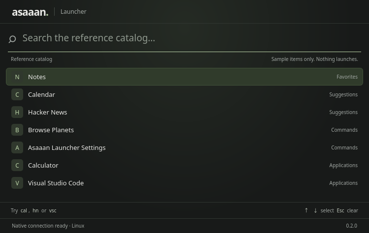

# CP002: Shared search core

**Local implementation, tests, package and native deployment passed. Awaiting user review/publication before CP003.**

Branch: checkpoint-2. Product version: 0.2.0. Reference: Floe 5b26e9d7a0240243251d7421bee5b90da5f52b9b. New commit author and committer: Dani-Bhai, 62589953+Dani-Bhai@users.noreply.github.com. Existing published history is not rewritten.

The user explicitly authorized starting this checkpoint after reviewing CP001 locally and creating checkpoint-2. CP001's earlier publication hold is superseded for that transition; no CP001 release is invented.

## What changed

- Separate asaaan-search Rust library with no Tauri/OS dependency.
- Exact fuzzy tiers, best scattered alignment, grapheme offsets, canonical equivalence and Swift-compatible case handling.
- Frecency buckets, exact/prefix aliases, keyword penalty, capped usage/favorite boosts, stable top results and empty-query browsing.
- Pure contribution merge order and filter boundaries: sectioned, pinned, ranked, optional-source sections, appended. No native provider implementations yet.
- Value-only items/context support application and command categories. Full Floe RootItem cases, quicklink alias derivation, scopes, async sources and typing coalescing remain future work.
- Native reference-catalog screen, immediate query updates, late-response suppression, bounded arrow selection, Escape clear, errors/retry and IME-safe key handling. Sample items are explicitly identified and never launch applications.
- Cargo workspace with a root lockfile and the existing src-tauri/target location. Existing third-party locked versions are preserved; the Unicode normalization dependency is added.
- Local deployment uses the current checkpoint/version and rejects a stale installed checkpoint; packaging can coexist with older checkpoint Debian files.

## Parity evidence

All 38 declarations in the original RankingTests.swift are mapped to Rust tests, retaining original names and parameter arrays. Four pure merge tests from SearchProviderTests.swift are also mapped. Two additional merge regressions cover hidden-row boundaries, source placement and provider interleaving. [Test map](../../tests/reference/test-map.json) and [source provenance](../../tests/reference/README.md) are committed. npm run parity:check fails on changed reference hashes or missing mapped functions. This is a bounded CP002 mapping, not a claim that all Floe search suites are ported.

The independent oracle compiles Floe's unchanged Fuzzy.swift and actual Ranking enum body using Swift 6.2 on Linux. Test adapters supply plain item/result data, English section labels and stable Algorithms helpers. It produces 775 matcher input/output cases (including the original 540-case grid) and 20 ranking snapshots. Rust replays these frozen outputs, including exact matched positions. npm run parity:swift was run separately and verified the frozen outputs again. Swift is optional test tooling and is never bundled.

This comparison caught two differences: Rust's contextual Greek final-sigma lowercasing, and byte-prefix aliases splitting an emoji grapheme. Both were corrected. The validation covers the frozen cases, not every Unicode version or the full macOS application.

## Validation

| Check | Result |
|---|---|
| npm run check | Passed: TypeScript, provenance/test-map checks and 14 frontend tests |
| npm run native:check | Passed: workspace formatting, 47 Rust tests and Clippy all-targets with warnings denied |
| Shared core | 38 Floe ranking tests + 6 merge tests + 2 independent oracle/Unicode tests |
| Native identity test | 1 Rust wire-contract test |
| Original Swift oracle | 775 matcher cases + 20 ranking snapshots; regeneration check passed |
| Original performance assertion | 10,000 candidates within the original 500 ms limit |
| Production package | Passed: Linux x86_64 Debian package, about 1.92 MiB |
| Installed native smoke | Passed: ASAAAN_NATIVE_SMOKE_OK CP002 query=cal results=Calendar,Calculator; exit 0 |
| Native display | Installed application opened on X11; 750 × 474 window screenshot inspected |
| macOS/Windows/Wayland | Not run; cross-platform CI configuration prepared |
| Public release / push | Not performed; staged local package available for review |

The smoke test waits until the search view receives and renders cal results, then sends their IDs to Rust for validation. Identity readiness alone cannot pass it. Ordinary use starts with the empty reference catalog. Try cal, hn (alias) or vsc (initials), then arrows and Escape.

## Local artifacts

Installed package SHA-256:

    629a5ada5388543a4dd586d5fc4563ac39d40aa7f436fbda1a88289470ee4d50

Installed binary SHA-256:

    0b0b4ccfe0c2a7ea74de5da545d5ff6b2c2246eb436b91d520b516cf44eff324

Staged package: .artifacts/checkpoint-002/asaaan-launcher_0.2.0_amd64.deb with SHA256SUMS and logs. Installed path: deployments/linux/current. Use npm run start:local to reopen it. This is a workspace-local install, not a system-wide package installation.

## Next gate

Review the local CP002 build. Publish the validated checkpoint only when ready, then explicitly start CP003. Application discovery, real launch actions, hotkeys, resident supervision, extensions and other features were not started in CP002.
