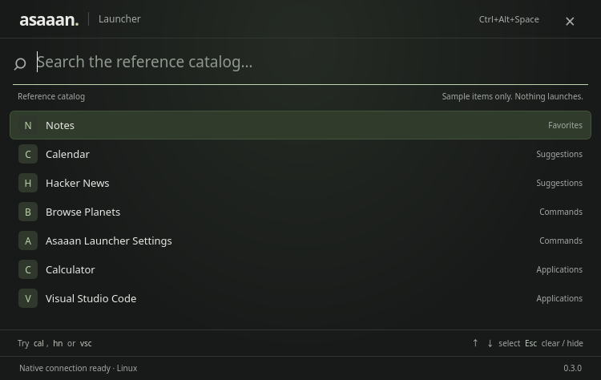

# CP003: Resident lifecycle and disposable launcher panel

Status: implemented, tested, packaged, installed and run locally on Linux X11. Ready for local user review. Performance feasibility and public/cross-platform release gates remain open. Branch: checkpoint-3. Product version: 0.3.0.

The user explicitly approved CP003 after reviewing CP002 locally. This authorizes the transition; no public CP002 release is claimed. All new commits use Dani-Bhai for author and committer.

## Scope

A windowless Tauri resident owns the tray, global Ctrl+Alt+Space shortcut and a single managed foreground process. The same executable runs with --panel over inherited stdin/stdout pipes. Only the foreground creates a webview or performs reference-catalog searches. Hide, Escape with an empty query, window close and loss of focus dismiss the panel. Native presentation subscribes before readiness and acknowledges DOM focus; the X11 device test separately verifies the operating-system focus owner before sending keys. Deferred sequence-checked blur handling rejects transient X11 shortcut-grab focus events. Hidden foregrounds report idle after 750 ms without finite work and are shut down/reaped. Reopening during that interval reuses the foreground; reopening during shutdown waits for a fresh process.

The protocol uses typed bounded newline-delimited JSON, private inherited pipes, off-UI-thread writes, monotonically increasing request sequences, generation-tagged callbacks, a ten-second readiness watchdog, three failed startup attempts and bounded shutdown. Parent pipe EOF ends the child. Work leases are acquired before finite work and released by ownership; watchers will not take leases. Delivered requests are never replayed after a crash.

The tray offers Show, Hide and Quit. A second ordinary invocation forwards Show to the existing resident. --background starts only the resident; --hide forwards dismissal; --quit exits the resident and its child. --panel and smoke roles bypass the single-instance plugin. Global shortcut registration failures are visible in the tray and panel, while tray access remains available.

Discovery, real application launch actions, settings processes, specialized hotkeys, clipboard authority, extensions and full visual parity remain later checkpoints.

## Reference tests

Pinned Floe revision: 5b26e9d7a0240243251d7421bee5b90da5f52b9b. Unmodified lifecycle sources/tests and SHA-256 provenance live in tests/reference/lifecycle. The map covers all 20 original test declarations: 10 lifetime tests, 5 process tests and 5 ownership tests. 18 have CP003 equivalents; clipboard ownership and specialized emoji/menu-bar hotkey routing are explicitly deferred. No byte-for-byte Swift Codable protocol compatibility is claimed: Rust participants share a typed JSON protocol. Opaque built-in requests substitute for unimplemented action payloads in lifecycle tests.

Rust process tests exercise real child processes, launch failures, crashes, watchdogs, graceful-shutdown-ignoring children, ordered delivery, idle reopen and EOF. The Rust watchdog uses immediate Child::kill for an unready child, rather than Floe's SIGTERM-to-SIGKILL escalation. Graceful ready-child shutdown has a two-second bound. A fixture executable is test tooling and is never packaged.

## Native validation

| Check | Result |
|---|---|
| npm run check | Passed: TypeScript, both provenance maps and 20 frontend tests |
| npm run native:check | Passed: formatting, 71 Rust tests and Clippy all-targets with warnings denied |
| Existing CP002 coverage | Retained 47 tests, including all 38 original ranking declarations and frozen Swift oracle cases |
| CP003 Rust coverage | 10 lifetime, 3 work ownership, 7 process and 4 framing tests |
| Linux production package | Passed: 0.3.0 amd64 Debian package, about 2.70 MiB |
| Installed search smoke | Passed: cal rendered Calendar then Calculator through React/Tauri/Rust |
| Installed resident smoke | Passed: three distinct native foregrounds searched, hid and were reaped; native panel exited after stdin EOF |
| Shortcut conflict | Separate resident smoke passed with explicit shortcut-unavailable status while another resident owned the key |
| X11 device check | Passed: actual Ctrl+Alt+Space, toggle/reopen within idle grace, Escape, single-instance forwarding, focus restoration and clean Quit |
| Renderer cleanup | All three foregrounds and their six observed WebKit helper processes exited; idle resident retained no children |
| Native tray | Registered expected labels; real D-BusMenu Show/Hide/Quit routing passed for the explicit resident PID |
| Native interface | Installed 750 × 474 screenshot inspected below |
| Other OSes, Wayland, public release | Not executed/published; remain pending |

The initial keyboard test incorrectly sent Escape before KDE completed native activation. It now checks the actual focus-window ancestry and owning PID before sending keys. This measures interactive readiness separately from DOM presentation and avoids treating a webview focus acknowledgement as proof of desktop focus. Cold interactive presentation measured 1,116 / 1,183 / 1,186 ms; DOM-ready presentation was 799 / 815 / 854 ms. These are local desktop observations including the test adapter, process startup, WebKit and window-manager activation, not isolated benchmarks or latency parity claims.

## Memory feasibility

The X11 check took cold and three dismissed samples, followed by twelve five-second settled samples. A separate native tray layout traversal was sampled. Values are Linux KiB converted to MiB; RSS and PSS are different metrics.

| Observation | Resident RSS | Resident PSS |
|---|---:|---:|
| Maximum across cold/dismissed/settled samples | 49.47 MiB | 21.68 MiB |
| After native tray layout traversal | 49.26 MiB | 21.55 MiB |

The proposed 30 MiB RSS target is **not met**. PSS is below 30 MiB in this run; that does not make RSS pass or establish equivalence with Floe’s macOS physical-footprint budget. Tauri still links native GTK/WebKit libraries in the resident even without a foreground renderer process. This remains an architecture/performance review item before expanding the project. Tray layout traversal used the native D-BusMenu endpoint; visual tray-popup rendering and the original macOS memory harness were not certified.

An additional active-screen snapshot recorded foreground plus WebKit helpers at roughly 399.45 MiB summed RSS / 167.38 MiB summed PSS, excluding the resident. Summed RSS double-counts shared pages. These measurements describe the current sample catalog, not a full indexed workload, and do not pass an active-UI memory parity gate. The memory and cold-start costs remain visible feasibility gaps.

## Local artifacts

Package SHA-256:

    e424a06f003662ded2fd101005b27db3f0f75b20ddc681a674608e829d562fd9

Installed binary SHA-256:

    9d4536b08b2c0fc964abe8f58b81edf75954780c3e4f708ecb493972ebad3a5d

The same package is staged at .artifacts/checkpoint-003/asaaan-launcher_0.3.0_amd64.deb with SHA256SUMS, installation manifest, validation logs, process/memory JSON and tray evidence. Installed under deployments/linux/current using workspace-local extraction, not the system package database. npm run start:local starts that installed resident. No public upload or push was performed by this task.

## Platform limitations

Linux X11 is the local native target. The global-shortcut backend uses X11 on Linux; Wayland shortcut registration is explicitly disabled with a tray fallback until a portal/compositor adapter is implemented and tested. macOS and Windows adapters are configured but not locally run. macOS uses accessory activation for the resident. Window positioning/focus and tray behavior require native qualification on each target.

Linux RSS and PSS are recorded separately from the reference's macOS physical-footprint measurement. The proposed resident target is 30 MiB; a miss must remain visible. Foreground and toolkit overhead must not be hidden by changing metric names. Cold presentation includes launching WebKit and is not a warm search-latency measurement.

## Next gate

Review the installed CP003 build and remaining feasibility gaps. Public publication remains pending. Do not start CP004 in this task.
